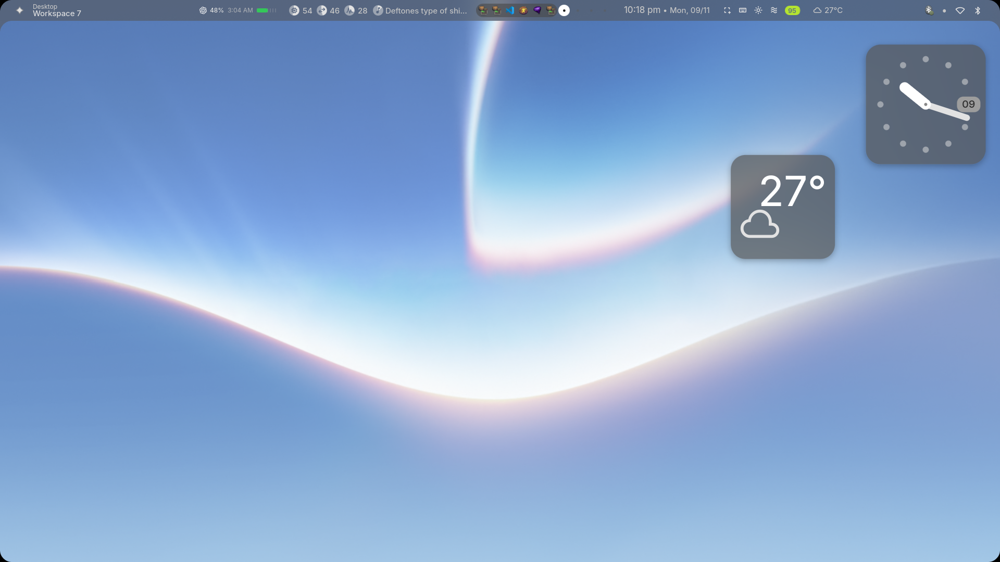
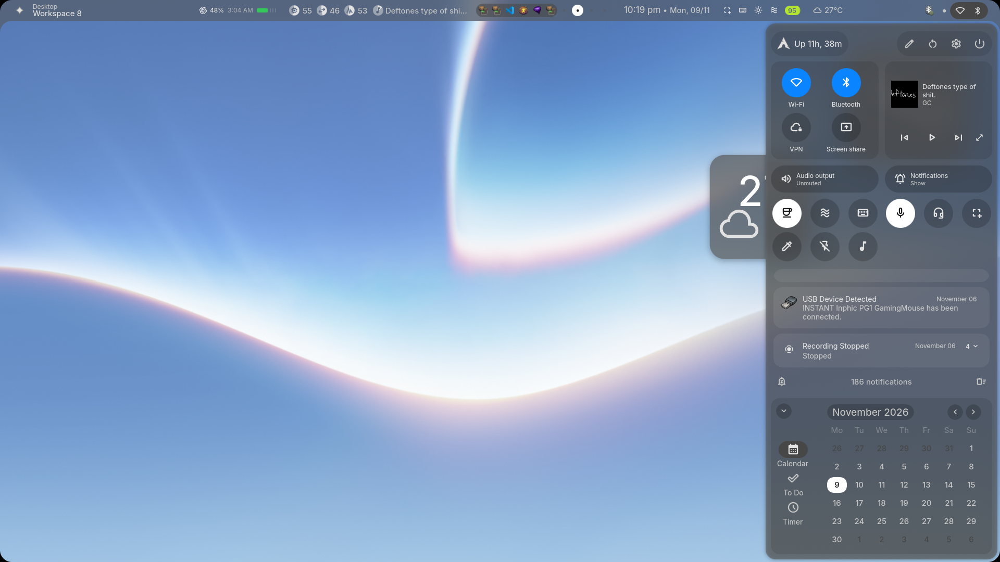
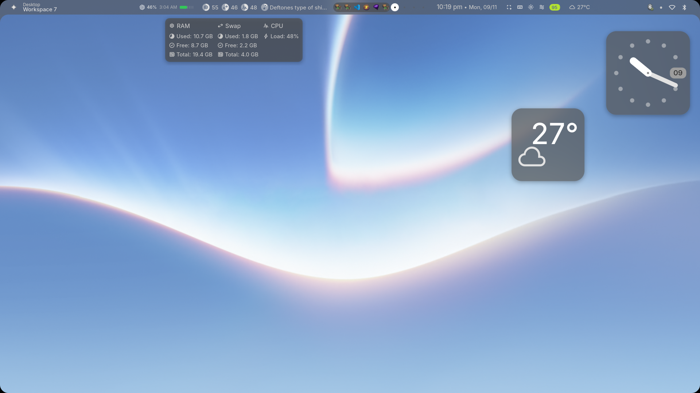

# Hyprland dotfiles

My personal Hyprland setup: a borderless, glassy desktop built on top of
[end-4/dots-hyprland](https://github.com/end-4/dots-hyprland) (illogical-impulse)
with a custom material treatment — no window outlines, translucent surfaces, a
heavier blur pass, and soft elevation instead of a painted border.

The look is driven by three things: the **quickshell `ii`** shell (bar, widgets,
sidebars, overview), a **glass material** applied to both windows and shell
surfaces, and a **motion system** with expressive easing. Everything personal
lives in `hypr/custom/`; `hypr/hyprland/` is the upstream base.



| Control center | System resources |
| --- | --- |
|  |  |

## Stack

| Piece | Choice |
| --- | --- |
| Compositor | Hyprland 0.56.2 (Wayland) |
| Shell / bar / widgets | [quickshell](https://quickshell.org/) with the `ii` config from dots-hyprland |
| Terminal | kitty (`TERMINAL=kitty -1`) |
| Lock screen | hyprlock (quickshell lock first, hyprlock fallback) |
| Idle | hypridle |
| Wallpaper | dots-hyprland `switchwall.sh` pipeline + a restore hook |
| Fonts | Google Sans Flex (UI), JetBrains Mono Nerd Font (terminal) |
| Hardware | Intel i7-6700HQ, Intel HD 530 + NVIDIA 940MX, 1920×1080 eDP-1 |

## Repository layout

```
dotfiles/
├── hypr/                       → symlinked to ~/.config/hypr
│   ├── hyprland.conf           entry point; sources everything below
│   ├── hyprland/               upstream dots-hyprland defaults
│   │   ├── general.conf        gaps, rounding, blur, animations, input, gestures
│   │   ├── keybinds.conf       184 binds, Super-driven
│   │   ├── execs.conf          autostart (quickshell, hypridle, cliphist, …)
│   │   ├── env.conf            Wayland, multi-GPU, Qt, terminal env
│   │   ├── rules.conf          window rules (dialogs, pickers, …)
│   │   ├── colors.conf         accent/border colors
│   │   └── scripts/            launcher, capture, zoom, workspace helpers
│   ├── custom/                 ← my overrides (the interesting part)
│   │   ├── general.conf        glass material: borders, opacity, blur, shadow
│   │   ├── rules.conf          frosted layer rules for quickshell surfaces
│   │   ├── keybinds.conf       GPU toggle, presentation mode, capture
│   │   ├── env.conf            personal env vars (currently empty)
│   │   ├── execs.conf          personal autostarts
│   │   └── scripts/            wallpaper restore hook
│   ├── hyprlock.conf           lock screen layout
│   ├── hyprlock/colors.conf    lock colors (matugen-generated)
│   ├── hypridle.conf           lock → DPMS off → suspend timers
│   ├── monitors.conf           monitor layout (nwg-displays)
│   └── workspaces.conf         workspace rules (nwg-displays)
├── assets/                     README screenshots
├── docs/design-implementation.md   how the design is built, value by value
└── install.sh                  symlinks hypr/ → ~/.config/hypr
```

## Design at a glance

| Token | Value | Where |
| --- | --- | --- |
| Window border | `border_size = 0` | `custom/general.conf` |
| Window opacity | `0.96` active / `0.92` inactive | `custom/general.conf` |
| Blur | size `6`, passes `3`, `ignore_opacity = true`, `vibrancy = 0.4` | `custom/general.conf` |
| Shadow | range `24`, offset `0 6`, power `3`, `rgba(00000050)` | `custom/general.conf` |
| Shell blur cutoff | `ignore_alpha 0.45` | `custom/rules.conf` |
| Gaps | `4` inner / `5` outer | `hyprland/general.conf` |
| Radius | `18`, rounding power `2.4` (squircle) | `hyprland/general.conf` |
| Motion | `emphasizedDecel` / `menu_decel` / `expressive…` beziers | `hyprland/general.conf` |

The full rationale — why `ignore_opacity` is on, why shell surfaces need a lower
`ignore_alpha`, how the layer namespaces are grouped, and how to retune the
material — is in **[docs/design-implementation.md](docs/design-implementation.md)**.

## Install

Prerequisites: a working [end-4/dots-hyprland](https://github.com/end-4/dots-hyprland)
install (Hyprland, quickshell, the `ii` shell, fonts and icons). This repo
replaces the config, not the packages.

```sh
git clone https://github.com/justrhey/hyprland-dotfiles.git ~/dotfiles
cd ~/dotfiles
./install.sh          # backs up an existing ~/.config/hypr, then symlinks
hyprctl reload        # or re-login
```

`install.sh` is idempotent: it detects an existing symlink, replaces a stale
one, and moves a real directory to `~/.config/hypr.bak.<timestamp>`.

Because `~/.config/hypr` is a symlink into the repo, editing the config and
committing are the same action:

```sh
$EDITOR ~/.config/hypr/custom/general.conf
git -C ~/dotfiles commit -am "tune blur"
git -C ~/dotfiles push
```

## Key bindings

Super is the modifier. The upstream cheatsheet (`Super` `/`) is authoritative;
these are the personal additions.

| Binding | Action |
| --- | --- |
| `Super` `Return` | Terminal (first available) |
| `Super` `Tab` | Workspace overview |
| `Super` `Space` (Super release) | Search / launcher |
| `Super` `N` | Toggle right sidebar (control center) |
| `Super` `A` | Toggle left sidebar |
| `Super` `V` | Clipboard history |
| `Super` `/` | Keybind cheatsheet |
| `Super` `Z` | Capture overlay |
| `Super+Shift` `S` | Region screenshot |
| `Super` `G` / `Super+Shift` `G` | Toggle GPU / show GPU status |
| `Super+Alt` `P` | Presentation / mirror mode |
| `Ctrl+Super` `R` | Restart quickshell |
| `Ctrl+Super` `/` | Edit shell config |
| `Ctrl+Super+Alt` `/` | Edit this repo's keybinds |

## Notes and gotchas

- **Upstream files move.** `hypr/hyprland/` is dots-hyprland's; a dots update
  can overwrite it. Keep personal changes in `hypr/custom/`.
- **Machine-specific env.** `hypr/hyprland/env.conf` pins
  `AQ_DRM_DEVICES=/dev/dri/card1:/dev/dri/card0` and `LIBVA_DRIVER_NAME=iHD` for
  this Intel + NVIDIA 940MX laptop. Change it for different hardware.
- **Monitors.** `monitors.conf` and `workspaces.conf` are written by
  `nwg-displays`; re-run it instead of hand-editing if you can.
- **Lock fallback.** `hypridle.conf` asks quickshell to lock, then falls back to
  `hyprlock` if neither `qs` nor `quickshell` is running.
- **No secrets.** Nothing in this repo is credential-bearing; `custom/env.conf`
  is intentionally empty of tokens.

## Credits and license

- Base config, scripts and `ii` shell: [end-4/dots-hyprland](https://github.com/end-4/dots-hyprland) (GPL-3.0).
- Glass material, layer rules and personal keybinds: mine.

GPL-3.0. See [LICENSE](LICENSE).
